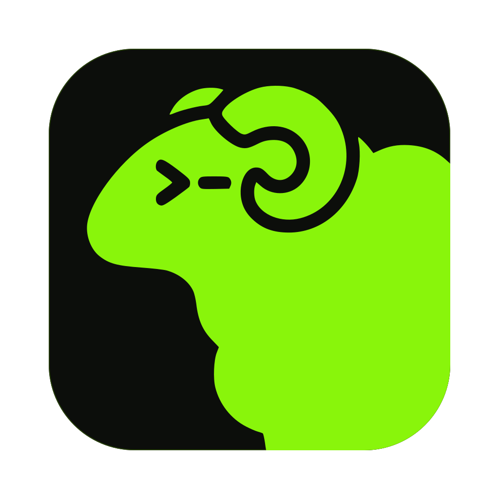

<p align="center">
  
</p>

<h1 align="center">Herdr — geocine fork</h1>

<p align="center"><b>Herdr, made for Windows.</b><br>
Your terminals and coding agents come back after a reboot.</p>

---

## What is this?

- A fork of [Herdr](https://github.com/herdrdev/herdr-app).
- Made and tested for **Windows** and **Git Bash**.
- Comes with its own core: [geocine/herdr-core](https://github.com/geocine/herdr-core/tree/geocine).
- New to Herdr? Read the [original README](https://github.com/herdrdev/herdr-app/blob/master/README.md).

## Install

Open **PowerShell**. Paste this:

```powershell
powershell -c "irm https://raw.githubusercontent.com/geocine/herdr-app/geocine/distribution/install-geocine.ps1 | iex"
```

Done. It installs the app **and** the core.

- **Update:** run the same line again. Herdr tells you when a new version is out.
- **Your terminals keep running** during the install.
- **Git Bash** becomes the default shell, if you have it.
  Don't want that? Set `HERDR_NO_GIT_BASH=1` first.
- Want to check the script first? [Read it here](distribution/install-geocine.ps1).

## What's new in this fork

### Reboot-proof
- Your terminals come back after a reboot, with the same screen and folder.
- Your agent comes back to **the same conversation**.
  Works with Claude Code, Codex, pi, OpenCode and Grok.
- Many tabs with the same agent in one folder? Each tab gets **its own**
  conversation back.
- Turn on `start_core_at_login` in settings: your terminals are back before you
  even open Herdr.

### Geocine layout (the default)
- Three panels beside your terminals, one click each in the tab bar:
  - **Files**: your project as a tree. Git colors, search, right-click menu.
    Click a file to read it: Markdown, code with colors, images.
    The line you're on shows who changed it last, like GitLens; full mode adds a blame column.
  - **Changes**: what changed, as diffs. Stage, unstage, discard, commit.
  - **Graph**: every branch and commit. Checkout, merge, rebase and more.
    Click a commit to see its diff.
- **Full mode**: the expand button opens any panel almost as big as the window.
- Herdr's own look, light and dark. Want green? Pick **geocine dark** in Settings → Look.
- `Ctrl+B` folds the sidebar to a slim rail and back, like VS Code.
- Herdr's own layout is still there: `Ctrl+Shift+L` switches.

### Windows + Git Bash
- Herdr follows your folder when you `cd` in Git Bash.
- Agents started from Git Bash (`pi`, `codex`, `opencode`) are seen and resumed.
- Agents use Git Bash too.

### Spaces
- Each space keeps its own folder.
- Open any folder as a space: the `+` button, or the New menu.

### Updates
- You get a notice when a new fork version is out. **On** by default.
- You can also get a notice when upstream Herdr has new changes. **Off** by default.
- Settings → Updates: a switch for each, and a **Check for updates** button.
- It also shows how this build compares to upstream.

### Settings
- Settings → Look: show or hide the **Files**, **Changes** and **Graph** panels.

### Privacy
- **No usage data.** Nothing is collected or sent.
- **No feedback sending.** Nothing is sent.

## Make a release

For the fork owner. Needs `gh`, and both repos on the `geocine` branch.

```powershell
scripts/fork-release.ps1 -Publish
```

Build from source: see the [original README](https://github.com/herdrdev/herdr-app/blob/master/README.md#build-from-source).
